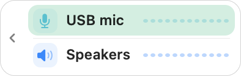
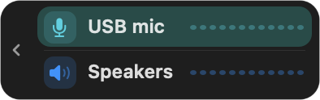
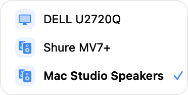
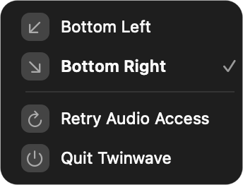

# Twinwave 1.3.2

Twinwave is a small native audio panel for Macs running macOS 14.2 or later. The local build script targets Apple silicon; the App Store Xcode scheme builds for Apple silicon and Intel. The top row follows the default input. While the selected mic is idle, twelve stationary dots mark the baseline. When another process uses that mic, an inset mint or dark teal highlight appears behind the input controls, even during silence. After the last other client releases the mic, Twinwave closes its input stream and clears its peak history. The bottom row follows the default output. Each meter shows the last twelve peak measurements, with the newest on the right.

## Screenshots

Light and dark appearances, plus the output picker and placement menu. These views are rendered from Twinwave’s native UI; the highlighted microphone uses a sample active-input state.

| Light appearance | Dark appearance |
| --- | --- |
|  |  |

| Choose an output | Place the panel |
| --- | --- |
|  |  |

## Build and run

With Apple's Command Line Tools or Xcode and the macOS 14.2 SDK or newer installed, run `./build.sh` in this directory. The optimized, ad-hoc signed app is written to `build/Twinwave.app`. Set `SIGN_IDENTITY` to use a local signing certificate instead. Copy the app to Applications and open it.

## Controls

Click the chevron to see full device names. Click a name to choose a system default from its menu. Drag an icon, type label, meter, or empty part of the panel to float it. Right-click for Bottom Left, Bottom Right, Retry Audio Access, or Quit Twinwave. A corner choice collapses the panel and puts it behind ordinary windows. Twinwave remembers the last placement and display across launches.

## Audio access

Allow microphone and system audio recording when macOS prompts. If access was previously denied, enable Twinwave in System Settings → Privacy & Security under Microphone or Screen & System Audio Recording, then use Retry Audio Access. Relaunch if macOS requests it. A disconnected microphone displays “No input.” A running capture that stops delivering buffers displays “No audio data.”

Every quarter second, Twinwave checks other Core Audio processes for active input on the selected mic. This check only reads properties. When another client is active and permission is granted, input uses an input-only HAL audio unit bound to the default microphone. Output uses private, unmuted Core Audio process taps scoped to the selected output's streams. A private aggregate device reads the taps. Both paths reduce each incoming buffer to a peak, and the UI retains twelve levels per row. The app does not write audio files or use the network.

## Mac App Store build

The shared **Twinwave App Store** Xcode scheme uses App Sandbox and builds a universal app. Copy `Configuration/Local.xcconfig.example` to `Configuration/Local.xcconfig` and enter your own enrolled developer team. Do not commit signing configuration, certificates, or provisioning profiles.

The store release is being prepared; a source build is not an approved App Store release. See [release preparation](docs/APP_STORE.md).

## Tests and privacy

Run `bash scripts/test.sh` for audio-buffer boundary checks. Run Xcode’s Analyze action on the App Store scheme for static analysis. Live metering, permission, routing, and device compatibility still require hardware checks.

Twinwave stores panel placement preferences locally. It does not save recordings, upload audio, collect analytics, or require an account. See [privacy](docs/PRIVACY.md) and [security review](docs/SECURITY_REVIEW.md).

[Support and bug reports](https://github.com/XiupengMa/Twinwave/issues) · [MIT license](LICENSE)
